<p align="center">
  
</p>

<h1 align="center">MediaOS</h1>

<p align="center">
  <strong>A TV home screen for a small Linux media box.</strong><br>
  Your Jellyfin and Plex libraries, the streaming apps you use and the box's own settings, all on one
  remote-friendly screen.
</p>

<p align="center">
  <a href="https://github.com/GoblinRules/MediaOS/releases/latest"><strong>Download the installer</strong></a> ·
  <a href="USER-GUIDE.md"><strong>User guide</strong></a> ·
  <a href="#being-worked-on">What's still being worked on</a>
</p>

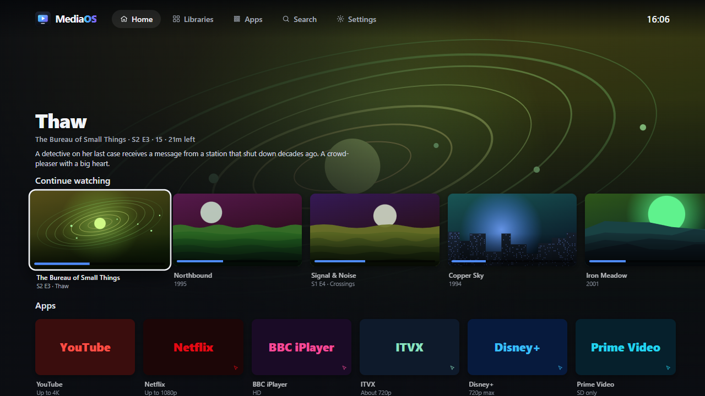

MediaOS turns a small PC under the TV into something that feels like a TV box. It starts straight into a home
screen. Everything works with the arrows, OK and Back on a remote, and there is no desktop, no mouse and no
command line to deal with.

> **Early days.** MediaOS works and has been tested end to end in a virtual machine. It has not yet had its
> full round of checks on real mini PCs and TVs. See [Being worked on](#being-worked-on).

## What it does

- **Your own films and shows.** Add a Jellyfin server (found on your network for you) or a Plex account (sign
  in with a code on your phone). Continue watching, Next up and Recently added appear on Home, with sort and
  filter in every library.
- **Network folders and USB drives.** No server needed: play films straight from a shared folder on a PC,
  Mac or NAS (computers on your network are found for you), or from a USB drive you plug in. MediaOS only
  reads them, never changes them.
- **Proper playback.** Films play in mpv with your choice of audio track and subtitles, skip back and forward,
  resume where you left off, and the next episode plays automatically.
- **Streaming apps.** YouTube (TV layout), Netflix, BBC iPlayer, ITVX, Channel 4, My5, Disney+, Prime Video
  and others open full screen. Each tile says honestly what picture quality to expect on Linux.
- **Search** across all your libraries with an on-screen keyboard.
- **Settings a non-technical person can use:**
  - Wi-Fi and cable. A fixed address or a different DNS goes in safely: the box tries the change and puts the
    old settings back by itself unless you say "Keep".
  - Picture size, text size, screensaver and sound.
  - Your normal TV remote over HDMI-CEC, Bluetooth remotes, game controllers and headphones, or a phone as a
    remote.
  - Home screen rows, weather beside the clock, and subtitle and language choices.
- **Updates from this page.** Check, install, go back to the previous version, or let the box update itself
  overnight. Updates are signed, and a power cut part-way through is repaired at the next start.
- **Recovery.** Hold Home for a menu that restarts things, resets the network or saves a problem report.

## Screenshots

| | |
|---|---|
| 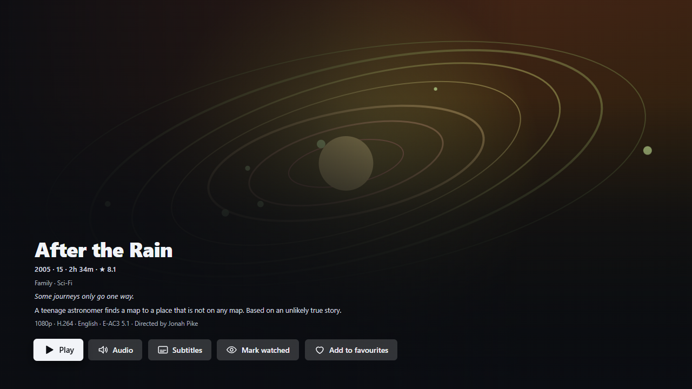 | 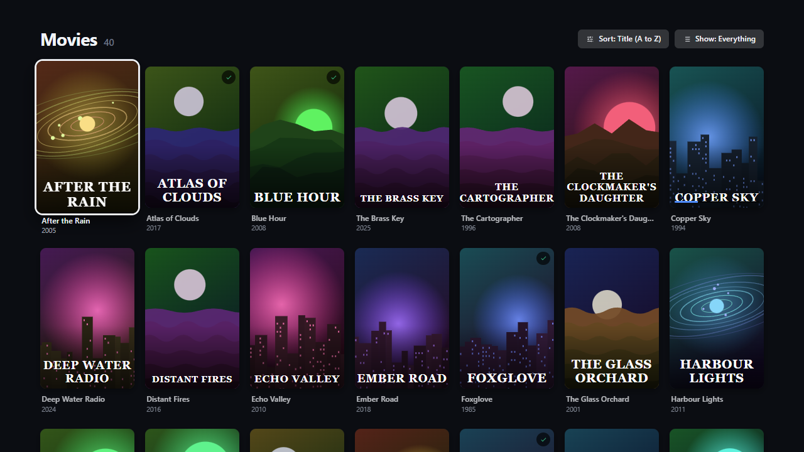 |
| Film details | A library, sorted and filtered |
| 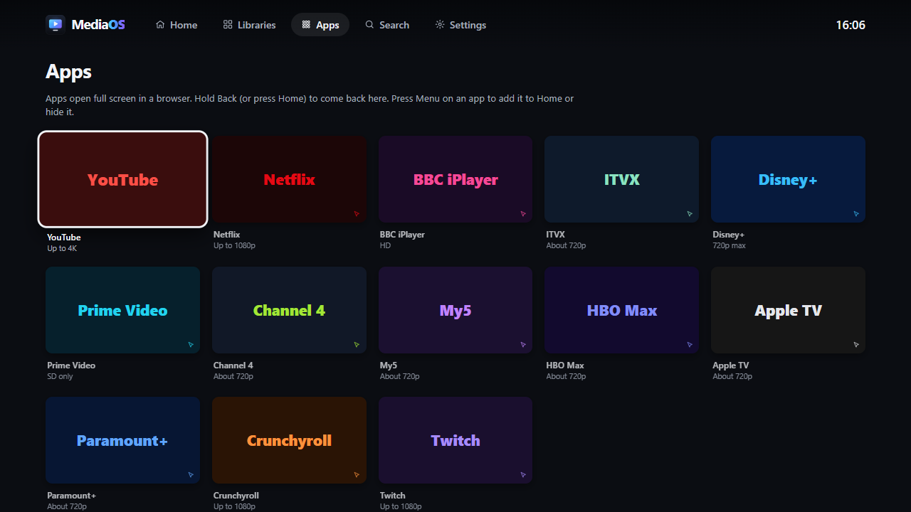 | 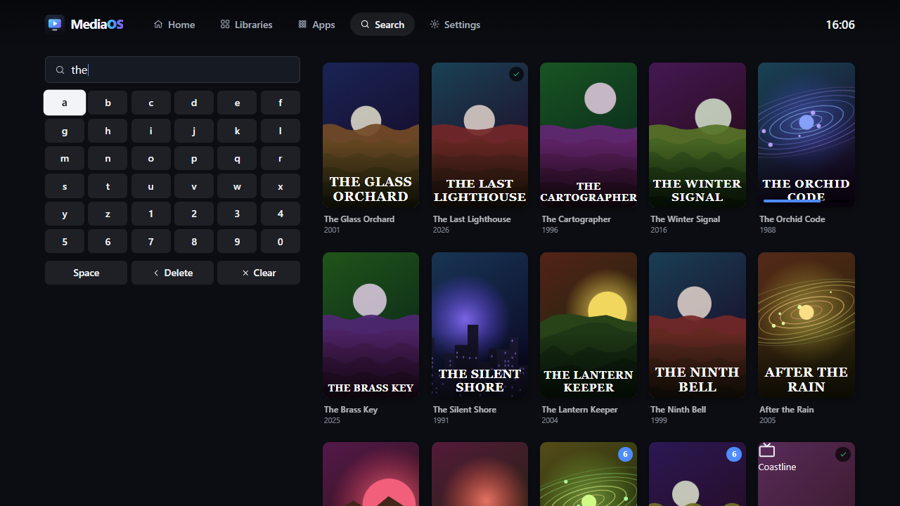 |
| Streaming apps, with honest quality labels | Search across every library |
| 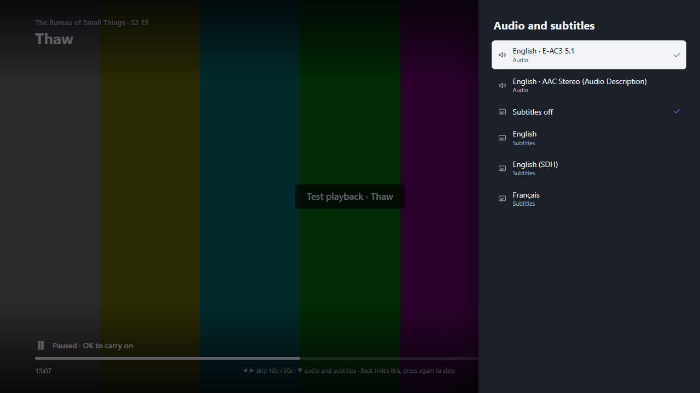 | 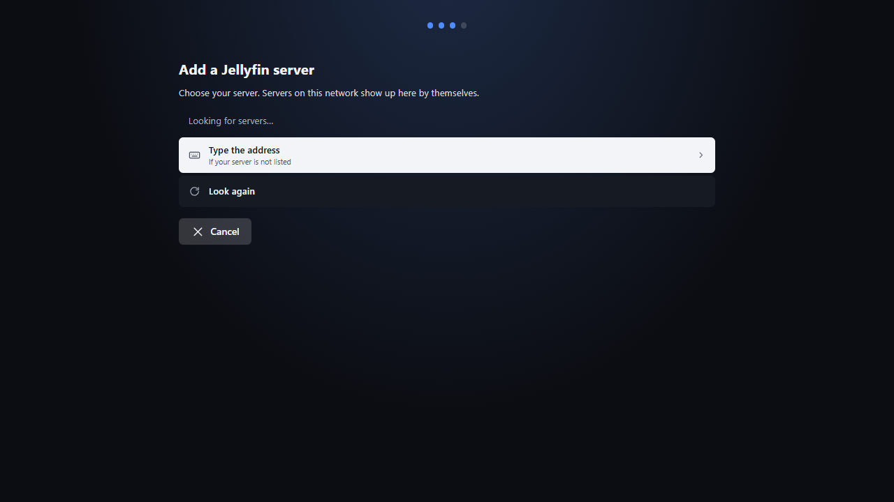 |
| Audio and subtitles while watching | Adding a Jellyfin server |
| 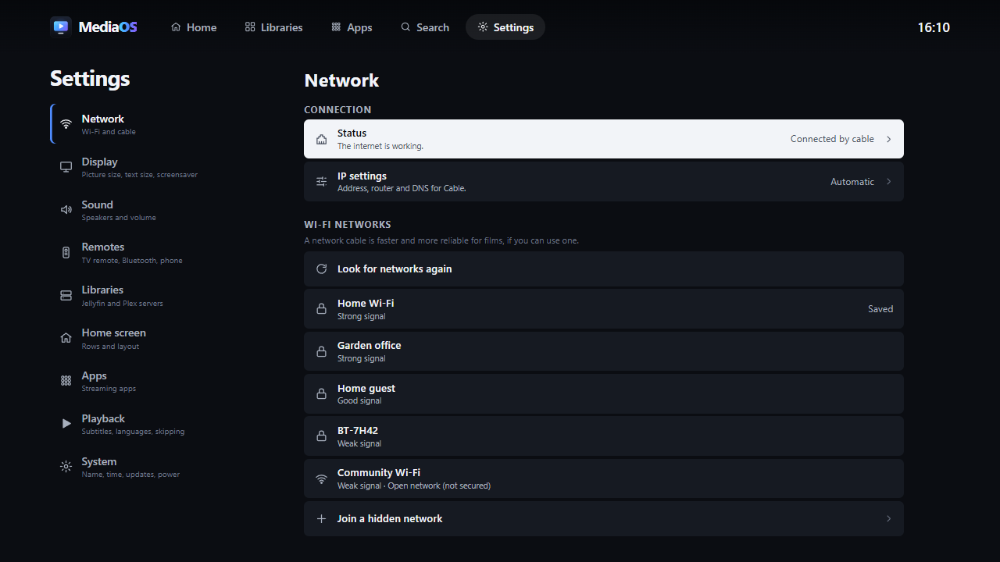 | 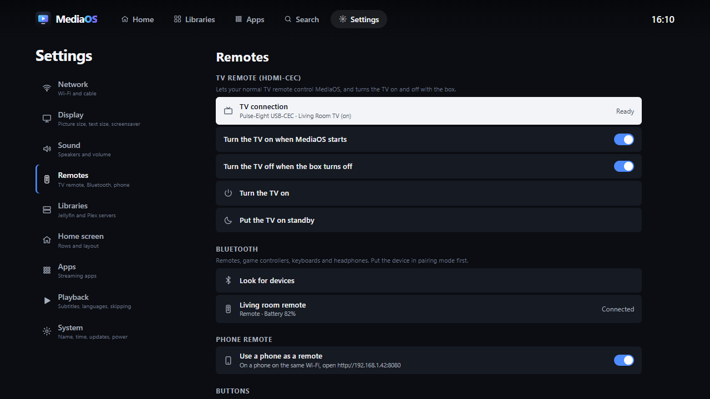 |
| Network | TV remote, Bluetooth and phone remote |
| 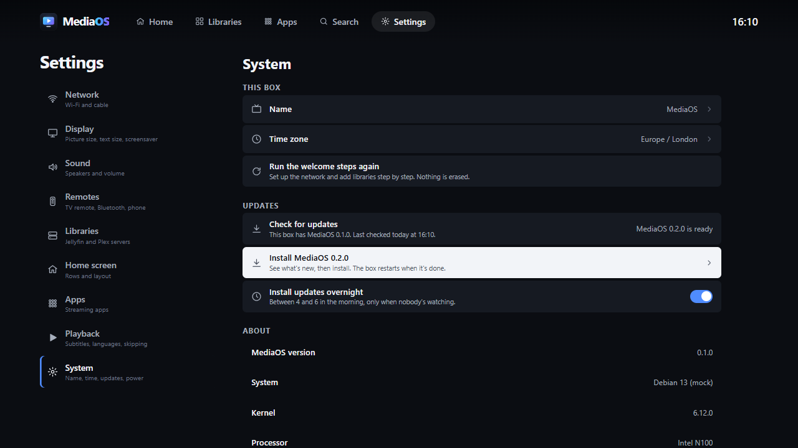 | 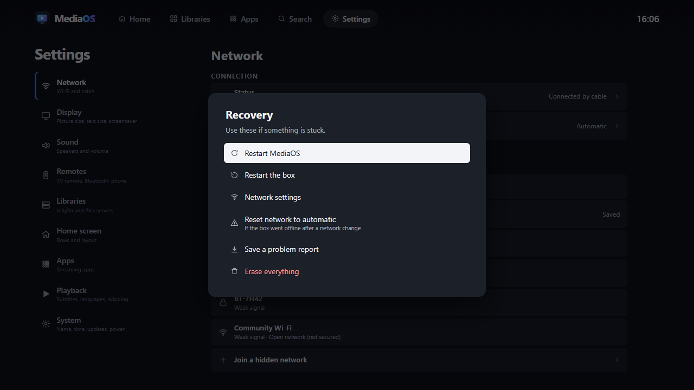 |
| Updates | Recovery (hold Home) |

The screenshots come from mock mode, with a made-up demo library.

## Install it on a box

**You need:**

- A small x86-64 PC with UEFI, for example an Intel N100 mini PC, connected to the TV by HDMI. **MediaOS
  uses the whole internal disk.**
- A network cable for the install. The installer downloads part of the system as it goes.
- A USB stick of 2 GB or more.
- A USB keyboard for the few minutes of installing. After that the remote does everything.

**Steps:**

1. Download `mediaos-release-<version>.iso` and its `.sha256` file from the
   [latest release](https://github.com/GoblinRules/MediaOS/releases/latest).
2. Check the download is complete. On Windows, in PowerShell:

   ```
   Get-FileHash .\mediaos-release-*.iso -Algorithm SHA256
   ```

   The long code it prints must match the one in the `.sha256` file. On Linux or macOS use
   `sha256sum` or `shasum -a 256`.
3. Write the image to the USB stick with [balenaEtcher](https://etcher.balena.io/) or
   [Rufus](https://rufus.ie/). In Rufus, pick "DD Image mode" if it asks.
4. Plug the stick into the box, switch it on and choose the USB stick from the boot menu. The key for this
   menu is often F7, F11 or F12; your PC's manual will say. Secure Boot can stay on.
5. Choose **Install MediaOS**. The installer asks one question: whether to erase the disk. Say yes, and it
   does the rest by itself. Take the USB stick out when it restarts.
6. The box starts into the welcome steps: get online, add your Jellyfin or Plex server, and start
   watching. The [user guide](USER-GUIDE.md) walks through each step.

## Updates

New versions are published on this page's [Releases](https://github.com/GoblinRules/MediaOS/releases). A
box finds them in **Settings › System › Check for updates**, or overnight if you turn that on. Every release
is signed, and a box only installs packages signed with the MediaOS key.

## Being worked on

These parts are not finished yet, or have only been tested in a virtual machine:

- **Checks on real hardware.** Hardware video decoding, TV remotes over HDMI-CEC on real TVs, Bluetooth
  remotes and game controllers, 5.1 and 7.1 sound, and a 24-hour run without problems.
- **Picture polish.** Matching the TV's refresh rate to the film (24p judder), HDR, and a "the picture froze"
  safety net.
- **Sound passthrough** of Dolby Digital and DTS to an amplifier.
- **Plex's newer sign-in method.** The current one works; Plex is moving to a new one.
- **Streaming apps.** Each service decides how well it works on Linux: Prime Video is SD only and
  most others top out around 720p or 1080p. NOW blocks Linux; its tile says so and suggests a TV stick on
  another HDMI input instead.
- **VPN per app**, for example BBC iPlayer through a UK VPN while everything else connects directly. This is
  designed but **not built yet**.
- **Network folders and USB drives** are new. They have been tested in a virtual machine with a Samba share and
  simulated FAT and ext4 drives, but not yet with many real NAS boxes, Windows PCs or USB sticks.

**Not planned:** live TV and recording, games, a general desktop, Android apps, Dolby Vision, TrueHD or DTS-HD
passthrough, and 4K or HDR from paid streaming services. MediaOS never works around copy protection.

## For developers

### Try it on Windows or Linux (mock mode)

Needs Node 22.12 or newer.

```
npm install
npm run dev
```

Away from the box, the shell runs in mock mode with a built-in demo library, so every screen can be tried
without a media server. Use the arrow keys, Enter for OK, Esc for Back, F1 for Home and M for Menu.

### How it's built

- **Shell:** Electron, React and TypeScript, driven entirely by a remote, keyboard, game controller or HDMI-CEC.
- **Playback:** mpv, with hardware decoding on real hardware.
- **Streaming apps:** Google Chrome app windows under the sway compositor.
- **Box:** Debian 13. The installer image sets up the session, NetworkManager, Bluetooth, the TV remote
  adapter and signed updates.

### Checks

```
npm run typecheck
npm run lint
npm test
npm run e2e
```

### Building the installer image

`os/build/build-remote.sh [dev|release]` builds the image on a Linux box with Docker. Set
`MEDIAOS_BUILD_HOST` (user@host) in the environment or in `os/build/local.env`, which git ignores. The dev
image lets your SSH key in for testing. Only the release image is ever published.

`os/build/release-github.sh <notes file>` then publishes a release. The build box signs the packages, and the
signing key never leaves it. Each release is a complete signed apt repository, plus the installer image after
a release build.

## Licence

No licence is granted for this code yet. All rights reserved.
