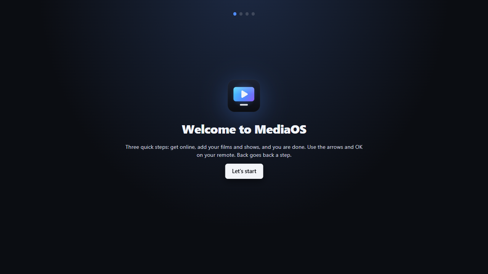
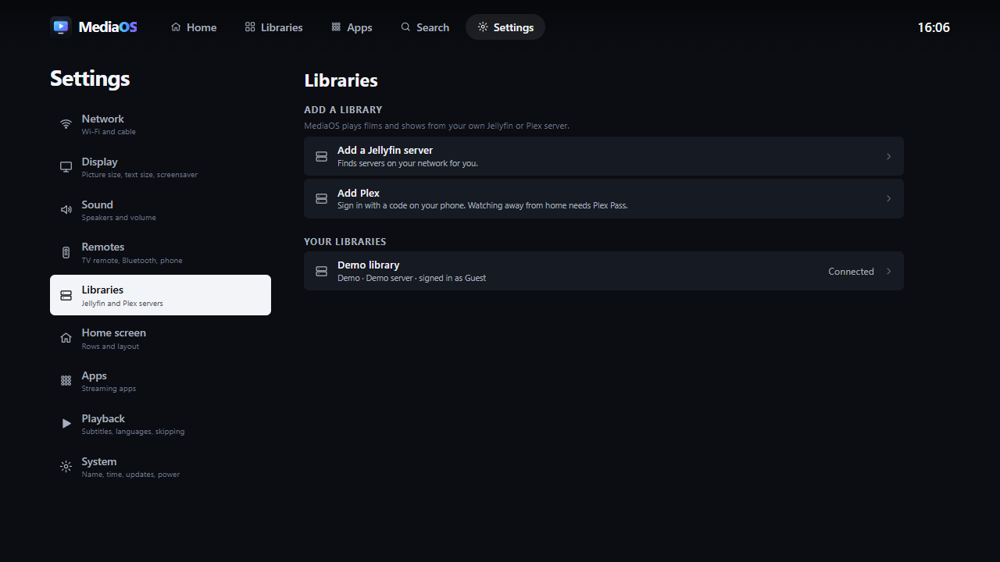
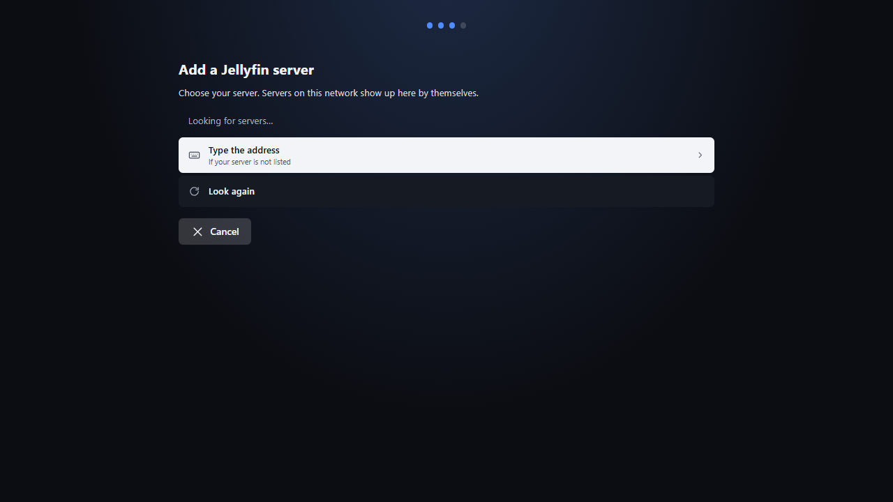
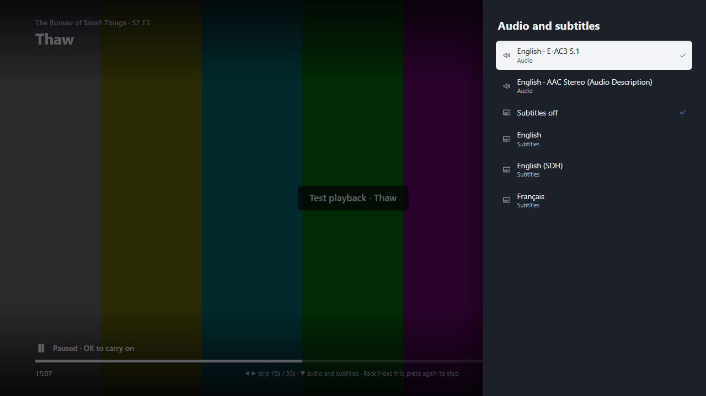
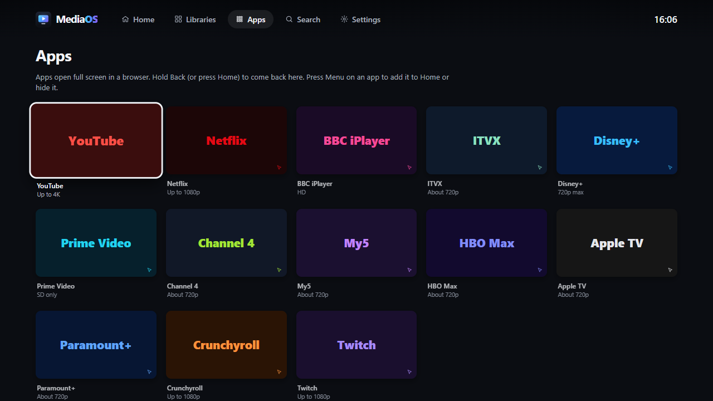
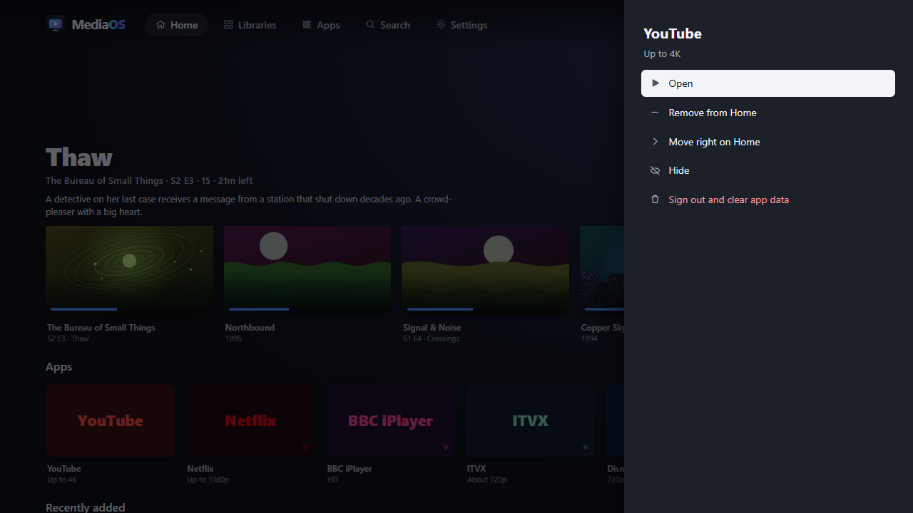
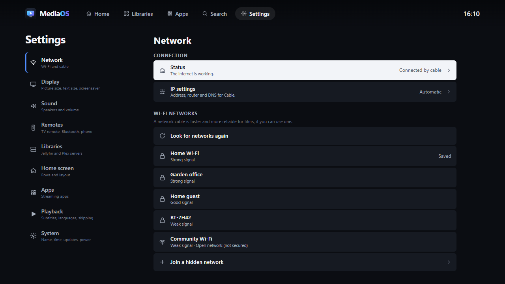
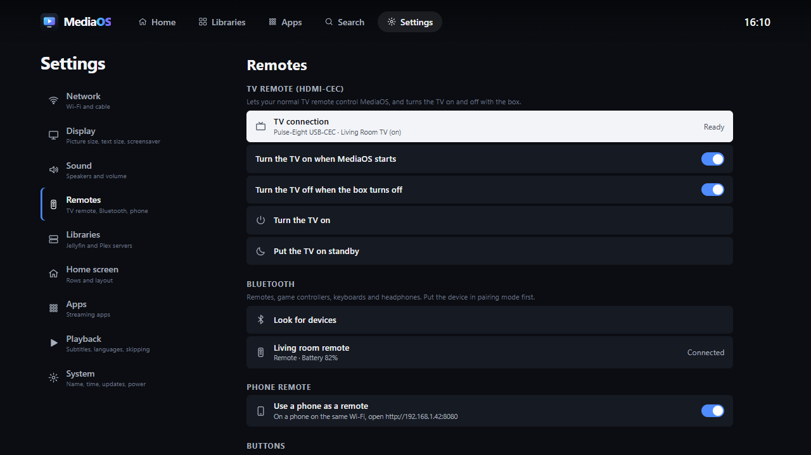
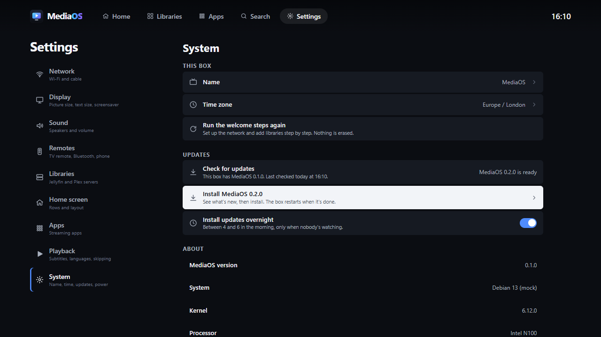
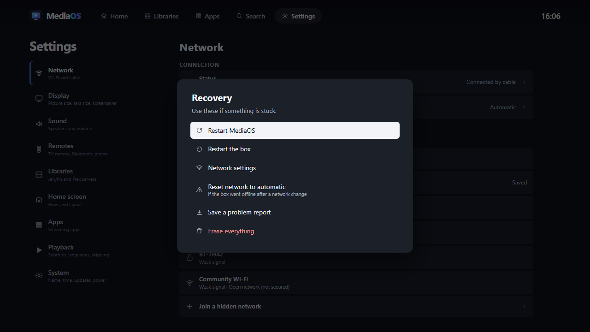

# MediaOS user guide

How to set up and use a MediaOS box: getting online, connecting your Jellyfin or Plex server, streaming apps,
remotes and updates. To put MediaOS on a box in the first place, see
[Install it on a box](README.md#install-it-on-a-box) in the README.

**Contents**

1. [The buttons](#1-the-buttons)
2. [First start: the welcome steps](#2-first-start-the-welcome-steps)
3. [Connecting your libraries (Jellyfin and Plex)](#3-connecting-your-libraries)
4. [Watching films and shows](#4-watching-films-and-shows)
5. [Streaming apps](#5-streaming-apps)
6. [Network: Wi-Fi, cable, fixed address and DNS](#6-network)
7. [Remotes: TV remote, Bluetooth and phone](#7-remotes)
8. [Picture and sound](#8-picture-and-sound)
9. [The Home screen](#9-the-home-screen)
10. [Updates](#10-updates)
11. [Recovery: when something is stuck](#11-recovery)
12. [VPN](#12-vpn)
13. [Troubleshooting](#13-troubleshooting)

---

## 1. The buttons

Everything works with the arrows and a handful of buttons.

| Button | Press | Hold |
|---|---|---|
| **Arrows** | Move around | |
| **OK** | Choose | Options for the thing you're on (same as Menu) |
| **Back** | Go back a step | Jump to Home, even from inside an app |
| **Home** | Go to Home from anywhere | Recovery menu (about 1.5 seconds) |
| **Menu** | Options for the thing you're on | In an app that needs a pointer: turn the arrows into a pointer |
| **Play/Pause** | Play the film or show you're on, or pause it | |

Many TV remotes keep their own Home button for the TV, which is why **holding Back** also takes you Home.

**Other ways to control it:**

- **Keyboard:** arrows and Enter. Esc is Back, F1 is Home, M is Menu and F12 is Power.
- **Game controller:** A is OK, B is Back, Start is Menu, and the Xbox or PlayStation button is Home.

You can see this list on the box too, in **Settings › Remotes › Buttons**.

## 2. First start: the welcome steps

The first time the box starts, it walks you through three short steps:

1. **Get online.** If a network cable is plugged in, you're already connected; press **Next**. Otherwise
   choose your Wi-Fi network and type its password with the on-screen keyboard.
2. **Add your films and shows.** Choose **Add Jellyfin** or **Add Plex** (see the next section). You can skip
   this if you only want streaming apps, and add a server later.
3. **You're all set.** Press **Start watching**.

You can go through these steps again at any time from **Settings › System › Run the welcome steps again**.
Nothing is erased.

## 3. Connecting your libraries

MediaOS plays films and shows from your own **Jellyfin** or **Plex** server. You can add as many servers as
you like, and mix the two. Add them in **Settings › Libraries**, or during the welcome steps.

No server? MediaOS can also play films straight from a **shared folder** on a computer or NAS, or from a
**USB drive** (see [Network folders and USB drives](#network-folders-and-usb-drives) below).

### Jellyfin

1. Choose **Add a Jellyfin server**.
2. Servers on your home network appear by themselves. Choose yours.
   - If it isn't listed, choose **Type the address** and type it as it appears in your browser, for example
     `192.168.1.20:8096` or `https://jellyfin.example.com`.
   - **Look again** searches the network again.
3. Sign in, in one of two ways:
   - **Use a code (easiest).** The TV shows a short code. Open the Jellyfin app on your phone or computer,
     go to **Quick Connect** and enter the code. This needs Quick Connect switched on in your server's
     dashboard.
   - **Type your name and password** with the on-screen keyboard.

### Plex

1. Choose **Add Plex**.
2. The TV shows a code. On your phone or computer, go to **plex.tv/link**, sign in to Plex and type the
   code.
3. The TV signs in by itself. Choose which servers to show on this TV (your own, and any shared with you),
   then press **Add**.

> **Plex Pass:** watching from a Plex server *outside your home* needs Plex Pass. Servers in your own home work
> without it.

### Changing or removing a library

In **Settings › Libraries**, choose a server under **Your servers** to get:

- **Rename**: the name shown on the TV.
- **Sign in again** (Jellyfin) or **Sign in to Plex again**: use this if the box says it has been signed out.
- **Remove**: takes the library off this TV. Nothing is deleted from your server.

### Network folders and USB drives

Films kept in a shared folder on a Windows PC, a Mac or a NAS can play without Jellyfin or Plex. They appear
together in a library called **Folders**, one row for each folder or drive.

1. In **Settings › Libraries**, choose **Add a network folder**.
2. Computers on your home network appear by themselves. Choose yours. If it isn't listed, choose **Type the
   computer's name** and type its name or address, for example `NAS`, `192.168.1.20`, or the whole path such as
   `\\NAS\Films`.
3. Say how to get in:
   - **Type a user name and password**: the ones you use on that computer. On a Windows PC this is often the
     email address you sign in to Windows with.
   - **Open it as a guest**, for folders shared with everyone.
4. Choose the shared folder that has your films (or **Type the folder name** if it isn't listed).

MediaOS only ever *reads* these folders: it never changes or deletes anything on your computer. The password is
kept on the box only, where the TV apps can't read it.

**USB drives** need no setup: plug one in and it appears in Folders a few seconds later. Unplug it to remove it.

Films play with resume, and a subtitle file next to a film (for example `Film.en.srt` beside `Film.mkv`) is
picked up by itself. To take a network folder off this TV, choose it under **Network folders and USB drives**
and then **Remove**. If a computer was switched off, choose **Try again** once it's back on.

## 4. Watching films and shows

- **Home** shows Continue watching, Next up and Recently added from all your libraries.
- **Libraries** opens each library as a grid of posters. The **Sort** and **Show** buttons at the top change
  the order and what's shown (for example only unwatched).
- **Search** finds things across every library. Type with the on-screen keyboard; results appear as you
  type.
- Choose a film or show to see its details, then **Play**, **Resume**, **Mark watched** or **Add to
  favourites**. For a series, choose the season and episode.

**While watching:**

| Button | What it does |
|---|---|
| OK or Play/Pause | Pause and carry on |
| Left / Right | Skip back 10 seconds / forward 30 seconds (you can change these) |
| Down | Audio tracks and subtitles |
| Back | Hide the on-screen controls; press again to stop |

MediaOS remembers where you stopped, and your server does too, so you can carry on from another device.

**Settings › Playback** sets your usual choices:

- the skip lengths;
- **Play the next episode automatically**;
- **Preferred audio language**;
- **Subtitles**: Off, Only for foreign speech, or Always on;
- **Subtitle language** and **Subtitle size**;
- **Play the original file when possible**: best picture and less work for your server. Turn it off if films
  stutter.

## 5. Streaming apps

The **Apps** tab lists YouTube, Netflix, BBC iPlayer, ITVX, Channel 4, My5, Disney+, Prime Video, HBO Max,
Apple TV, Paramount+, Crunchyroll and Twitch.

- **Open an app** with OK. It fills the screen.
- **Sign in** inside the app itself, the same way you would on a computer. The box remembers it.
- **Come back** by holding **Back**, or by pressing **Home**.
- **Pointer apps.** Most apps besides YouTube are websites made for a mouse. Hold **Menu** to turn your
  remote's arrows into a pointer, or use a mouse or a Bluetooth remote with a pointer.
- **Options:** press **Menu** on an app tile to add it to Home, move it, hide it, or **Sign out and clear app
  data**. Hidden apps wait in a **Hidden apps** row at the bottom of the Apps screen; choose one and **Show in
  Apps** to bring it back.

**Picture quality.** Each tile says what to expect, because the streaming services decide this, not MediaOS:

| App | Best picture on MediaOS |
|---|---|
| YouTube | Up to 4K |
| Netflix, Crunchyroll, Twitch | Up to 1080p |
| BBC iPlayer | HD (needs a TV Licence) |
| ITVX, Channel 4, My5, HBO Max, Apple TV, Paramount+ | About 720p |
| Disney+ | 720p at most |
| Prime Video | SD only (Amazon's limit on Linux) |
| NOW | Not available: NOW blocks Linux |

For NOW, or for 4K from Netflix or Disney+, use a Google TV or Fire TV stick on another HDMI input of your TV.

## 6. Network

**Settings › Network** shows whether the box is online, and how.

- **Cable:** just plug it in. A cable is faster and more reliable for films than Wi-Fi.
- **Wi-Fi:** choose your network and type the password. **Look for networks again** refreshes the list, and
  **Join a hidden network** is for networks that don't show their name.

### Fixed address and DNS (optional)

Most homes never need this. **IP settings** lets you:

- give the box a **fixed address** (so it's always at the same place on your network), with its mask and router;
- choose a **DNS** service: Automatic (from your router), Cloudflare, Google, Quad9, or **Type my own**.

**Changes are tried safely.** When you save, the box switches to the new settings and asks **"Keep these
settings?"**. It checks the router, DNS and internet while you watch. If you don't press **Keep these
settings** within 45 seconds, or you press **Put back**, the old settings come back by themselves. That way a
typing mistake can't leave the box stranded offline.

If the box does end up offline after a change: hold **Home**, choose **Reset network to automatic**, then
restart the box.

## 7. Remotes

### Your normal TV remote (HDMI-CEC)

Most TVs can pass their remote's buttons to the box over the HDMI cable. Most PCs, though, can't receive them
without help. You need a small **Pulse-Eight USB-CEC adapter** between the box and the TV: plug the box's HDMI
into the adapter, the adapter's HDMI into the TV, and its USB cable into the box.

Then, in **Settings › Remotes › TV remote (HDMI-CEC)**:

- **TV connection** shows the adapter and your TV once they've found each other.
- **Turn the TV on when MediaOS starts** and **Turn the TV off when the box turns off**.
- **Turn the TV on** and **Put the TV on standby** try the connection straight away.

On the TV itself, the setting may have a brand name: Anynet+ (Samsung), SimpLink (LG), Bravia Sync (Sony),
VIERA Link (Panasonic) or EasyLink (Philips). Make sure it's switched on.

### Bluetooth remotes, controllers, keyboards and headphones

1. Put the device in pairing mode first. Its instructions say how; it's often a long press on a button until
   a light flashes.
2. In **Settings › Remotes › Bluetooth**, choose **Look for devices**. The box looks for about a minute.
3. Choose your device when it appears. If the TV shows a number, check it matches the device, then press OK.

Paired devices show the battery level where the device reports it. To remove one, choose it, then **Forget this
device**.

### A phone as a remote

Turn on **Use a phone as a remote**. On a phone on the same Wi-Fi, open the web address the TV shows (for
example `http://192.168.1.42:8080`). No app is needed.

## 8. Picture and sound

**Settings › Display:**

- **Picture size:** choose what your TV supports. A 4K TV is 3840 × 2160.
- **Text size:** makes everything on screen bigger or smaller.
- **Screensaver:** shows a clock after a while with no button presses. It never starts during a film.
- **Turn the screen off** after a longer while.

**Settings › Sound:** where the sound goes (the TV, or an amplifier or soundbar), the volume, the speaker
layout, **Play a test sound**, and **Button sounds**.

## 9. The Home screen

**Settings › Home screen:**

- turn rows on or off, and move them: press **Menu** (or hold OK) on a row, then **Move up** or **Move
  down**;
- **Big picture at the top**, and **One Continue watching row**, which merges Next up into Continue watching;
- **Weather beside the clock:** choose **Your town** and **Celsius (°C)** or **Fahrenheit (°F)**. It updates
  every 30 minutes and hides when the box is offline.

**Settings › System** has the box's **Name** (shown on your phone and in the Jellyfin and Plex dashboards) and
its **Time zone**.

## 10. Updates

In **Settings › System › Updates**:

- **Check for updates** looks for a new version.
- **Install MediaOS x.y.z** shows what's new, then installs it. The box restarts by itself when it's done,
  which takes a few minutes. **Don't switch it off meanwhile.** If the power does go off part-way through,
  the box repairs itself at the next start and tells you.
- **Install updates overnight** installs new versions between 4 and 6 in the morning, only when nobody is
  watching.
- **Go back to MediaOS x.y.z** returns to the version you had before, if something stopped working after an
  update. The box then won't reinstall that version overnight, but you can still install it yourself.

Every update is signed, and the box refuses anything without the MediaOS signature.

## 11. Recovery

**Hold Home** for about a second and a half, from anywhere, to open **Recovery**:

| Choice | When to use it |
|---|---|
| **Restart MediaOS** | The screen is stuck or behaving oddly. Quick, and the box stays on. |
| **Restart the box** | Restarting MediaOS didn't help. |
| **Network settings** | Go straight to Settings › Network. |
| **Reset network to automatic** | The box went offline after a network change. |
| **Save a problem report** | Saves a file of recent logs (no passwords) to send to whoever helps you. |
| **Erase everything** | Puts MediaOS back to how it was when new. Your libraries and sign-ins are removed from the box; nothing on your servers is touched. |

## 12. VPN

**Not built yet.** A VPN per app is designed and planned. For example, BBC iPlayer could go through a UK VPN
location while Netflix and your own servers connect directly. If the VPN drops, those apps would stop rather
than quietly use your normal connection.

Be aware that BBC iPlayer, Netflix and Disney+ block most commercial VPN servers. A VPN can make the traffic
go where you want, but it can't make a service accept it.

Until then, if you need a VPN, set it up on your router.

## 13. Troubleshooting

| Problem | Try this |
|---|---|
| "Can't reach" a server | Check the server is switched on and on the same network. In Settings › Libraries, choose the library and **Sign in again**. |
| A library says you're signed out | Settings › Libraries › choose it › **Sign in again**. |
| A network folder says it can't be reached | Check the computer is switched on and awake, then Settings › Libraries › choose the folder › **Try again**. If its password changed, remove the folder and add it again. |
| Films stutter or buffer | Use a network cable if you can. Or turn off **Play the original file when possible** in Settings › Playback, so your server sends a lighter version. |
| No picture on a 4K TV, or the wrong size | Settings › Display › **Picture size**. |
| No sound | Settings › Sound › **Play sound through**, then **Play a test sound**. |
| The TV remote does nothing | Check the Pulse-Eight adapter is between the box and the TV, and the TV's CEC setting is on (see [section 7](#7-remotes)). |
| An app shows a mouse pointer you can't move | Hold **Menu** to steer the pointer with the arrows. |
| Stuck in an app | Hold **Back**, or press **Home**. |
| Everything seems stuck | Hold **Home** › **Restart MediaOS**. |
| Offline after changing network settings | Hold **Home** › **Reset network to automatic**, then restart the box. |
| Something broke after an update | Settings › System › **Go back to MediaOS x.y.z**. |

If you need to ask someone for help, **Save a problem report** from the Recovery menu and send them the file.
